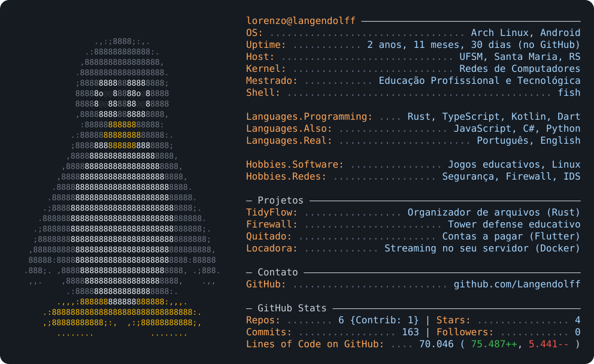

<a href="https://github.com/Langendolff">
  <picture>
    <source media="(prefers-color-scheme: dark)" srcset="dark_mode.svg">
    <source media="(prefers-color-scheme: light)" srcset="light_mode.svg">
    
  </picture>
</a>

# Olá, eu sou o Lorenzo 👋

Sou formado em **Redes de Computadores** pela UFSM e hoje faço **mestrado em Educação Profissional e Tecnológica**, também na UFSM. Gosto de fazer software que resolve problema de verdade, e ferramentas e jogos que ajudam a ensinar tecnologia.

### 🔧 Projetos

| Projeto | O que é | Stack |
| --- | --- | --- |
| [**TidyFlow**](https://github.com/Langendolff/TidyFlow) | Organizador automático de arquivos para Linux. Regras em TOML, sabe de qual site cada download veio, tudo desfazível e nada sobrescrito. | Rust · Tauri · TypeScript |
| [**Firewall: A Última Defesa**](https://github.com/Langendolff/firewall) · [▶ jogar](https://firewall-virid.vercel.app) | Tower defense educativo sobre portas de rede, regras de firewall, IDS e resposta a incidentes, em 10 fases. | JavaScript · Phaser |
| [**Quitado**](https://github.com/Langendolff/Quitado) | Controle simples de contas a pagar, sem conta, sem nuvem e sem anúncio. | Flutter · Dart |
| [**Locadora**](https://github.com/Langendolff/Locadora) | Seu serviço de streaming, no seu servidor: pedidos, downloads via VPN, legendas pt-BR e Jellyfin, configurados em um comando. | Python · Docker · Jellyfin |

### 🧰 Com o que eu trabalho

Também trabalho com redes, segurança e tecnologia aplicada à educação.

---

🇺🇸 <b>English</b>

 

# Hi, I'm Lorenzo 👋

I have a degree in **Computer Networks** from UFSM (Brazil) and I'm currently doing a **master's in Professional and Technological Education**, also at UFSM. I like building software that solves real problems, plus tools and games that help people learn tech.

### 🔧 Projects

| Project | What it is | Stack |
| --- | --- | --- |
| [**TidyFlow**](https://github.com/Langendolff/TidyFlow) | Automatic file organizer for Linux. TOML rules, knows which site each download came from, everything undoable and nothing overwritten. | Rust · Tauri · TypeScript |
| [**Firewall: The Last Defense**](https://github.com/Langendolff/firewall) · [▶ play](https://firewall-virid.vercel.app) | Educational tower defense game about network ports, firewall rules, IDS and incident response, across 10 levels (Portuguese). | JavaScript · Phaser |
| [**Quitado**](https://github.com/Langendolff/Quitado) | A simple bill tracker with no account, no cloud and no ads (Portuguese). | Flutter · Dart |
| [**Locadora**](https://github.com/Langendolff/Locadora) | Your own streaming service on your own server: requests, downloads over VPN, pt-BR subtitles and Jellyfin, set up with one command. | Python · Docker · Jellyfin |

I also work with networking, security and technology for education.

